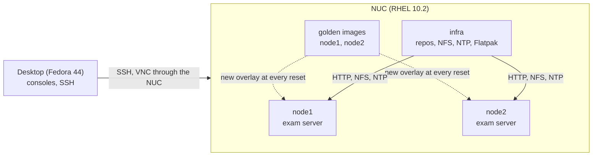

# EX200 Practice Lab

KVM home lab for the Red Hat EX200 exam, where 2 exam servers reset to a fresh install before every practice run.
An infra server gives them repos, NFS, NTP and Flatpak apps on a network with no internet.

A personal practice project, not affiliated with or endorsed by Red Hat, which owns the Red Hat and RHCSA trademarks.

## Highlights

- 21 practice exams and 11 drills ran in this lab from 9 to 26 October 2026.
- All 13 solo exams from 09 to 21 passed, with 265 to 300 of 300 points.
- Exams 13, 15, 16 and 19 met my readiness bar, but never 3 in a row.
- A reset gives node1 and node2 a new overlay on their golden image and 2 empty 5 GiB disks.

## Lab

The `exam` network has no forwarding and no DHCP, so the VMs have no internet and static addresses.
The infra server also has a NIC on the NAT network, only to fetch the Flatpak apps.

| Host | Address | Role | CPU / RAM |
|---|---|---|---|
| desktop | Home LAN | Fedora 44 workstation, SSH, VM consoles | i3-12100F / 16 GB |
| nuc | `172.25.250.1` | RHEL 10.2 KVM host, gateway without forwarding, DNS | i3-1315U / 16 GB |
| infra | `172.25.250.10` | Repos and Flatpak over HTTP, NFS, NTP | 2 CPU / 2 GB |
| node1 | `172.25.250.11` | Exam server, 20 GiB system disk, 2 empty 5 GiB disks | 2 CPU / 2 GB |
| node2 | `172.25.250.12` | Same as node1 | 2 CPU / 2 GB |

## Build and reset

The nodes run on qcow2 overlays over golden images, so a reset drops every change from a run.

| File | When | Result |
|---|---|---|
| [`build/exam-net.xml`](build/exam-net.xml) | Once | Isolated network `exam`, DNS for 3 hosts |
| [`build/infra.ks`](build/infra.ks) | Once | Install of infra with repos, NFS, NTP |
| [`build/flatpak-mirror.sh`](build/flatpak-mirror.sh) | Once, on infra | 2 Flathub apps in a repo signed with a lab key |
| [`build/node1.ks`](build/node1.ks), [`build/node2.ks`](build/node2.ks) | With every rebuild | Install of node1 and node2 |
| [`build/rebuild-nodes.sh`](build/rebuild-nodes.sh) | After a kickstart change | New golden images in about 10 min |
| [`build/reset.sh`](build/reset.sh) | Before every run | New overlays, 2 new empty disks per node |

## Practice runs

Claude generates each practice exam from my private task bank, organised by Red Hat's [EX200 objectives](https://www.redhat.com/en/services/training/ex200-red-hat-certified-system-administrator-rhcsa-exam), and scores it.
My own format is 3 h, 300 points and 210 to pass.

1. Reset node1 and node2 and set up the start state of the tasks with a setup script.
2. Solve the tasks on the VM consoles and over SSH, with no internet and no help.
3. Reboot both nodes when the time is up.
4. Score each task against its key by reading the nodes only, so a setting lost in the reboot scores 0.

## Results

My readiness bar is 3 exams in a row at 255/300 or more, within 2 h 30 min, with no area under 70%.
Every run is on the [practice results](practice-results.md) page.

| Runs | Count | Result |
|---|---|---|
| Guided exams 01–04 | 4 | All passed, 264 to 278 points |
| Exams 05–08 | 4 | 1 passed, 3 failed |
| Solo exams 09–21 | 13 | All passed, 265 to 300 points |
| Readiness bar met | 4 | Never 3 in a row |
| Drills | 11 | Shorter runs with help |

## Not in the repository

Only the lab build and the results are public.

- The tasks, their keys and the task bank stay private, so nothing here reads like exam content.
- The setup scripts of the runs stay private, because they show the start state of each task.
- The kickstarts carry `@ROOT_PASSWORD@`, and `rebuild-nodes.sh` fills it in from a local file.
- No Red Hat software is here, because infra serves the RHEL 10.2 DVD from a virtual CD-ROM drive.

## Tech stack

| Layer | Tools |
|---|---|
| Host | RHEL 10.2, KVM, libvirt |
| Network | libvirt network, dnsmasq |
| Install | Kickstart, virt-install, Bash |
| Services | Apache HTTP Server, NFS, chrony, Flatpak, OSTree, GnuPG |
| Workstation | Fedora 44, OpenSSH, virt-viewer |

## Roadmap

| Topic | Status |
|---|---|
| Exam network and node build | done |
| Infra server and Flatpak mirror | done |
| Practice exams and drills | done |
| Timed full exam before EX200 | planned |
| EX200 | planned |

## License

MIT, see [LICENSE](LICENSE).
